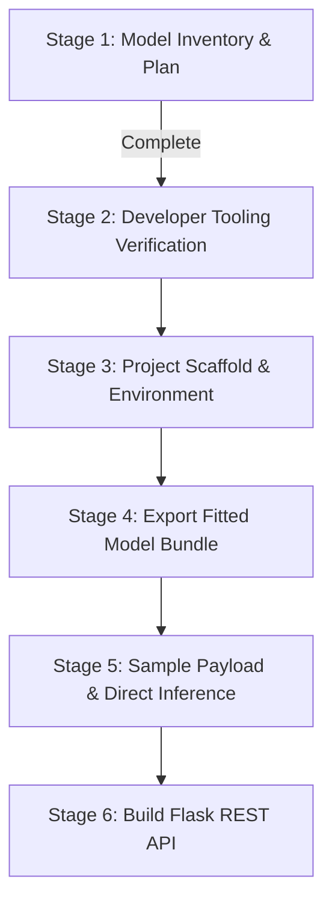

# Model Inventory & Deployment Readiness Report

**Project:** Robustness or Artifact? (PhiUSIIL Phishing URL Detection)  
**Target Architecture:** Flask REST API (`backend/`) + Angular 22 Frontend (`frontend/`)  
**Workspace:** `Robustness-or-Artifact`  
**Date of Inspection:** October 18, 2026  
**Auditor:** Automated Model Inventory Agent (DevOps CI/CD Pipeline Audit)

---

## Executive Summary

This inventory audits the repository before writing any Flask or Angular deployment code, adhering to the requirements of **Stage 1 (Project Plan and Inventory)** of the DevOps Lab.

**Critical Finding:** No serialized model artifact (`.pkl`, `.joblib`, `.json`, `.h5`, `.pt`, `.onnx`) exists on disk in this workspace. The training notebook [`phishing_xgboost_bert.ipynb`](file:///c:/Users/ASUS/OneDrive/Desktop/AIR/Assignments/7th%20Semester/DevOps/Robustness-or-Artifact/phishing_xgboost_bert.ipynb) trains four distinct models in memory (XGBoost, BERT-base, Logistic Regression with character TF-IDF, and a Regex heuristic), but never serialized or exported any fitted estimator or pipeline to disk. Furthermore, `xgboost` is currently not installed in the local Python environment.

Before building the Flask API (Stage 6) and Angular interface (Stage 8–10), the student must complete **Stage 4 (Package Student Model and Fitted Preprocessing)** by exporting a fitted scikit-learn `Pipeline` bundle (`model_bundle.joblib`).

---

## 1. Model Files & Saved Artifacts

### 1.1 Artifact Search Results

A recursive scan across the entire workspace directory for model and weight extensions (`.pkl`, `.joblib`, `.json`, `.h5`, `.pt`, `.pth`, `.bin`, `.onnx`, `.model`, `.safetensors`, `.ubj`) returned **zero (0) saved artifacts**:

| Parameter | Finding |
|---|---|
| **Files found on disk** | **None** (0 saved model files in repository root or subdirectories) |
| **Tracked files in Git** | [`README.md`](file:///c:/Users/ASUS/OneDrive/Desktop/AIR/Assignments/7th%20Semester/DevOps/Robustness-or-Artifact/README.md), [`Robustness_or_Artifact_Research_Proposal.docx`](file:///c:/Users/ASUS/OneDrive/Desktop/AIR/Assignments/7th%20Semester/DevOps/Robustness-or-Artifact/Robustness_or_Artifact_Research_Proposal.docx), [`phishing_xgboost_bert.ipynb`](file:///c:/Users/ASUS/OneDrive/Desktop/AIR/Assignments/7th%20Semester/DevOps/Robustness-or-Artifact/phishing_xgboost_bert.ipynb) |
| **Local disk size of artifacts** | `0 bytes` |

### 1.2 Inspection of Training Code for Save Commands

The training notebook [`phishing_xgboost_bert.ipynb`](file:///c:/Users/ASUS/OneDrive/Desktop/AIR/Assignments/7th%20Semester/DevOps/Robustness-or-Artifact/phishing_xgboost_bert.ipynb) was inspected cell by cell for serialization calls (`joblib.dump`, `pickle.dump`, `torch.save`, `save_pretrained`, `save_model`):

1. **XGBoost (Cell 7):**
   ```python
   # Cell 7 in phishing_xgboost_bert.ipynb
   xgb = XGBClassifier(n_estimators=300, max_depth=6, learning_rate=0.1,
                       tree_method='hist', random_state=42, n_jobs=-1)
   xgb.fit(X_num.iloc[train_idx], y[train_idx])
   report('XGBoost', y[test_idx], xgb.predict(X_num.iloc[test_idx]))
   ```
   *Quoted save line:* **None**. No `xgb.save_model(...)`, `joblib.dump(...)`, or `pickle.dump(...)` was executed.

2. **BERT-base (Cell 9):**
   ```python
   # Cell 9 in phishing_xgboost_bert.ipynb
   args = TrainingArguments(
       output_dir='bert_out', num_train_epochs=1, learning_rate=2e-5,
       per_device_train_batch_size=32, per_device_eval_batch_size=128,
       fp16=torch.cuda.is_available(), save_strategy='no', report_to='none', seed=42)
   ```
   *Quoted save line:* The notebook explicitly set `save_strategy='no'`. No checkpoint was written, and directory `bert_out` was not preserved.

3. **Logistic Regression & TF-IDF (Cells 13 & 14):**
   ```python
   # Cell 14 in phishing_xgboost_bert.ipynb
   def fit(col):
       vec = TfidfVectorizer(analyzer='char', ngram_range=(3, 5), min_df=3)
       m = LogisticRegression(C=1.0, max_iter=1000).fit(vec.fit_transform(col), train['label'])
       return vec, m

   vec_o, m_o = fit(train['URL'])
   vec_h, m_h = fit(train['URL'].map(host_only))
   ```
   *Quoted save line:* **None**. The fitted vectorizers and estimators (`vec_o`, `m_o`, `vec_h`, `m_h`) remained transient in Google Colab memory.

### 1.3 Artifact Python Type and Structure

* **Python Type:** `None` (No serialized file exists to load).
* **Dictionary Keys / Values:** `N/A`.

---

## 2. Problem Type and Target

### 2.1 Problem Type
* **Task:** **Binary Classification** (predicting whether a web URL / website is legitimate/benign or a phishing attempt).

### 2.2 Target Column Name & Meaning of Values

> [!WARNING]
> **Critical Target Semantic Inversion Found in Notebook:**  
> The notebook uses two different label encodings between sections. This distinction is vital for API response mapping.

| Context | Target Column | Value `0` Meaning | Value `1` Meaning | Class Distribution |
|---|---|---|---|---|
| **Original UCI Dataset & Cells 3, 7, 9** | `label` | **Phishing** | **Benign / Legitimate** | `0`: 100,945 (42.81%)<br>`1`: 134,850 (57.19%) |
| **Inverted Scheme (Cells 12–16 & README)** | `label` (`1 - y`) | **Benign / Safe** | **Phishing (Malicious)** | `0`: 134,850 (57.30%)<br>`1`: 100,508 (42.70%)* |

*\*Note: In Cell 12, deduplication reduced the total row count from 235,795 to 235,358 (437 duplicate URLs removed).*

### 2.3 Model Class Labels Order
* For standard binary classification in scikit-learn and XGBoost:
  * `model.classes_ = array([0, 1])`
  * Depending on which training cell is packaged:
    * If Cell 7 (XGBoost) is packaged: Class `0` = Phishing, Class `1` = Benign.
    * If Cell 14 (Logistic Regression) is packaged: Class `0` = Benign, Class `1` = Phishing.
* **Recommendation for Flask API:** The Flask endpoint must NOT return an ambiguous integer `0` or `1`. It should return explicit JSON:
  ```json
  {
    "prediction": "Legitimate",
    "is_phishing": false,
    "confidence": 0.9957
  }
  ```

---

## 3. Algorithm

### 3.1 Algorithms Used in Training
The repository examines four distinct modeling approaches:

1. **XGBoost Classifier (`XGBClassifier`):**
   * Hyperparameters: `n_estimators=300`, `max_depth=6`, `learning_rate=0.1`, `tree_method='hist'`, `random_state=42`.
   * Input: 50 extracted numeric/tabular features from HTML, DOM, and URL string characteristics.
   * Reported Test Accuracy: **1.0000 (100.0%)**, F1: **1.0000**.
2. **BERT-base Sequence Classifier (`BertForSequenceClassification`):**
   * Architecture: Pretrained `bert-base-uncased` with a 2-class sequence classification head.
   * Training: Hugging Face `Trainer`, 1 epoch, batch size 32, learning rate 2e-5, max sequence length 64 tokens.
   * Reported Test Accuracy: **0.9982 (99.82%)**, F1: **0.9984**.
3. **Logistic Regression (`LogisticRegression`):**
   * Hyperparameters: L2 regularization, `C=1.0`, `max_iter=1000`.
   * Feature representation: Character 3–5-gram TF-IDF (`TfidfVectorizer(analyzer='char', ngram_range=(3, 5), min_df=3)`).
   * Clean Test Accuracy: **0.9957 (99.57%)**, AUROC: **0.9988**.
4. **Deterministic Heuristic Rule (Baseline Audit):**
   * Regular Expression: `r'^https://www\.[^/?#]+/?$'`
   * Logic: Predicts `Benign` if URL matches the bare homepage template, else `Phishing`.
   * Accuracy: **0.9958 (99.58%)**. Matches trained ML models without training.

### 3.2 Ensemble / Meta-Learner Structure
* **Architecture:** **Independent Single Models.**
* There is no stacking, voting classifier, or meta-learner connecting the models. Each model was evaluated independently as a comparative baseline.

---

## 4. Preprocessing

### 4.1 Fitted Scikit-learn Pipeline
* **Is the saved artifact a fitted sklearn Pipeline that already includes preprocessing?**  
  **NO.** No pipeline object was created, fitted, or saved to disk in `phishing_xgboost_bert.ipynb`.

### 4.2 Preprocessing Steps Applied in Training

| Preprocessing Step | Details in Notebook | Fitted Object Saved? | Location on Disk |
|---|---|---|---|
| **Column Dropping (XGBoost)** | Dropped all 5 non-numeric columns (`FILENAME`, `URL`, `Domain`, `TLD`, `Title`) via `.select_dtypes(include=[np.number])`. | **No** (Implicit Pandas filter) | N/A |
| **Column Dropping (Text Models)** | Dropped all 54 tabular/metadata columns, retaining only `URL`. | **No** | N/A |
| **Row Deduplication** | In Cell 12: `df = df.drop_duplicates(subset='URL').reset_index(drop=True)` (dropped 437 duplicates). | **No** | N/A |
| **Imputation** | None applied. The dataset has **0 missing values** across all 50 numeric features. | **No** | N/A |
| **Scaling** | None applied. XGBoost operated directly on unscaled numeric counts and probabilities. | **No** | N/A |
| **Categorical Encoding** | None for XGBoost (text categoricals like TLD and Domain were dropped). | **No** | N/A |
| **Text Tokenization (BERT)** | Hugging Face `AutoTokenizer.from_pretrained('bert-base-uncased')`, `truncation=True, max_length=64`. | **No** (Standard base weights used; fine-tuned model not saved) | N/A |
| **Text Vectorization (LR)** | Scikit-learn `TfidfVectorizer(analyzer='char', ngram_range=(3, 5), min_df=3)`. Fitted on 164,901 training URLs. | **No** (Fitted vocabulary discarded after notebook execution) | N/A |
| **URL Normalization** | Unicode NFKC normalization, stripping control chars `[\x00-\x1f\x7f-\x9f]`, adding default `http://` scheme, IDNA hostname encoding. | **No** (Python helper function) | Notebook Cell 12 |
| **Host-Only Feature Engineering** | Stripping `www.` prefix and non-host path/query elements (`host_only(u)`). | **No** (Python helper function) | Notebook Cells 13 & 14 |

### 4.3 Custom Classes & Functions
If deploying models that rely on the notebook's custom logic, the following functions/classes must be available:
1. `URLDataset(torch.utils.data.Dataset)`: Required if serving BERT via PyTorch.
2. `normalize(url)`: Required if preprocessing raw user URLs before character n-gram extraction.
3. `host_only(url)`: Required if deploying the template-neutral model.

---

## 5. Input Feature Schema

The repository presents two distinct input modalities depending on which model is selected for deployment:
* **Option A:** The 50-feature tabular model (XGBoost).
* **Option B:** The URL-text model (Logistic Regression + TF-IDF or BERT).

### 5.1 Tabular Model (XGBoost) — Exact 50 Feature Schema
The model expects exactly **50 numeric features** in the exact order generated by `X.select_dtypes(include=[np.number])`:

| # | Feature Name | Dtype | Kind | Allowed Categories / Range | Unique Values | Semantics |
|---|---|---|---|---|---|---|
| 1 | `URLLength` | `int64` | number | `[13, 6097]` | 482 | Total character length of URL |
| 2 | `DomainLength` | `int64` | number | `[4, 110]` | 101 | Character length of domain name |
| 3 | `IsDomainIP` | `int64` | category (binary) | `[0, 1]` (0 = False, 1 = True) | 2 | Domain is an IP address |
| 4 | `URLSimilarityIndex` | `float64` | number | `[0.1556, 100.0]` | 36,360 | URL structural similarity score |
| 5 | `CharContinuationRate` | `float64` | number | `[0.0, 1.0]` | 898 | Rate of repeated consecutive characters |
| 6 | `TLDLegitimateProb` | `float64` | number | `[0.0, 0.5229]` | 465 | Historical legitimacy probability of TLD |
| 7 | `URLCharProb` | `float64` | number | `[0.0011, 0.0908]` | 227,421 | Character distribution probability |
| 8 | `TLDLength` | `int64` | number | `[2, 13]` | 12 | Character length of TLD string |
| 9 | `NoOfSubDomain` | `int64` | number | `[0, 10]` | 10 | Count of subdomains in host |
| 10 | `HasObfuscation` | `int64` | category (binary) | `[0, 1]` (0 = False, 1 = True) | 2 | Hex/percent obfuscation present |
| 11 | `NoOfObfuscatedChar` | `int64` | number | `[0, 447]` | 20 | Count of obfuscated characters |
| 12 | `ObfuscationRatio` | `float64` | number | `[0.0, 0.3480]` | 146 | Ratio of obfuscated characters |
| 13 | `NoOfLettersInURL` | `int64` | number | `[0, 5191]` | 421 | Total alphabetical letters in URL |
| 14 | `LetterRatioInURL` | `float64` | number | `[0.0, 0.9260]` | 709 | Ratio of letters to total length |
| 15 | `NoOfDegitsInURL` | `int64` | number | `[0, 2011]` | 182 | Total numeric digits in URL |
| 16 | `DegitRatioInURL` | `float64` | number | `[0.0, 0.6840]` | 575 | Ratio of digits to total length |
| 17 | `NoOfEqualsInURL` | `int64` | number | `[0, 176]` | 25 | Count of `=` characters |
| 18 | `NoOfQMarkInURL` | `int64` | number | `[0, 4]` | 5 | Count of `?` characters |
| 19 | `NoOfAmpersandInURL` | `int64` | number | `[0, 149]` | 31 | Count of `&` characters |
| 20 | `NoOfOtherSpecialCharsInURL` | `int64` | number | `[0, 499]` | 74 | Count of other special characters |
| 21 | `SpacialCharRatioInURL` | `float64` | number | `[0.0, 0.3970]` | 240 | Ratio of special characters |
| 22 | `IsHTTPS` | `int64` | category (binary) | `[0, 1]` (0 = False, 1 = True) | 2 | Scheme is HTTPS |
| 23 | `LineOfCode` | `int64` | number | `[2, 442666]` | 10,738 | HTML lines of code on page |
| 24 | `LargestLineLength` | `int64` | number | `[22, 13975732]` | 26,181 | Maximum length of single HTML line |
| 25 | `HasTitle` | `int64` | category (binary) | `[0, 1]` (0 = False, 1 = True) | 2 | HTML page has `<title>` tag |
| 26 | `DomainTitleMatchScore` | `float64` | number | `[0.0, 100.0]` | 152 | String match score: domain vs title |
| 27 | `URLTitleMatchScore` | `float64` | number | `[0.0, 100.0]` | 497 | String match score: URL vs title |
| 28 | `HasFavicon` | `int64` | category (binary) | `[0, 1]` (0 = False, 1 = True) | 2 | Page has favicon |
| 29 | `Robots` | `int64` | category (binary) | `[0, 1]` (0 = False, 1 = True) | 2 | `robots.txt` present |
| 30 | `IsResponsive` | `int64` | category (binary) | `[0, 1]` (0 = False, 1 = True) | 2 | Viewport responsiveness detected |
| 31 | `NoOfURLRedirect` | `int64` | category (binary) | `[0, 1]` (0 = False, 1 = True) | 2 | External URL redirects observed |
| 32 | `NoOfSelfRedirect` | `int64` | category (binary) | `[0, 1]` (0 = False, 1 = True) | 2 | Self-referencing redirects observed |
| 33 | `HasDescription` | `int64` | category (binary) | `[0, 1]` (0 = False, 1 = True) | 2 | Meta description tag present |
| 34 | `NoOfPopup` | `int64` | number | `[0, 602]` | 115 | Count of popup script elements |
| 35 | `NoOfiFrame` | `int64` | number | `[0, 1602]` | 119 | Count of `<iframe>` tags |
| 36 | `HasExternalFormSubmit` | `int64` | category (binary) | `[0, 1]` (0 = False, 1 = True) | 2 | Form action submits to external domain |
| 37 | `HasSocialNet` | `int64` | category (binary) | `[0, 1]` (0 = False, 1 = True) | 2 | Social media links present |
| 38 | `HasSubmitButton` | `int64` | category (binary) | `[0, 1]` (0 = False, 1 = True) | 2 | `<button type="submit">` present |
| 39 | `HasHiddenFields` | `int64` | category (binary) | `[0, 1]` (0 = False, 1 = True) | 2 | `<input type="hidden">` present |
| 40 | `HasPasswordField` | `int64` | category (binary) | `[0, 1]` (0 = False, 1 = True) | 2 | `<input type="password">` present |
| 41 | `Bank` | `int64` | category (binary) | `[0, 1]` (0 = False, 1 = True) | 2 | Banking keywords detected |
| 42 | `Pay` | `int64` | category (binary) | `[0, 1]` (0 = False, 1 = True) | 2 | Payment keywords detected |
| 43 | `Crypto` | `int64` | category (binary) | `[0, 1]` (0 = False, 1 = True) | 2 | Cryptocurrency keywords detected |
| 44 | `HasCopyrightInfo` | `int64` | category (binary) | `[0, 1]` (0 = False, 1 = True) | 2 | Copyright statement detected |
| 45 | `NoOfImage` | `int64` | number | `[0, 8956]` | 992 | Total images on page |
| 46 | `NoOfCSS` | `int64` | number | `[0, 35820]` | 209 | Total stylesheet links |
| 47 | `NoOfJS` | `int64` | number | `[0, 6957]` | 253 | Total script links |
| 48 | `NoOfSelfRef` | `int64` | number | `[0, 27397]` | 1,374 | Total same-domain hyperlinks |
| 49 | `NoOfEmptyRef` | `int64` | number | `[0, 4887]` | 296 | Total hyperlinks with empty `#` anchor |
| 50 | `NoOfExternalRef` | `int64` | number | `[0, 27516]` | 1,191 | Total hyperlinks pointing to external domains |

* **Target Column Check:** Confirmed. The target column `label` is **NOT** among the input features.
* **Non-numeric columns dropped:** `FILENAME`, `URL`, `Domain`, `TLD`, `Title`.

### 5.2 Text-Based Models (Logistic Regression / BERT) — Feature Schema
* **Raw Input:** Exactly 1 field:
  * Name: `URL` (string)
  * Allowed values: Any standard URL string (e.g. `https://www.southbankmosaics.com`, `http://login-apple.com/verify`)
* **Engineered Features:**
  * For Logistic Regression: Character n-grams (sizes 3, 4, and 5) extracted using fitted TF-IDF vocabulary.
  * For BERT: Token IDs, attention masks, and token type IDs from WordPiece vocabulary (`vocab.txt`).

---

## 6. Environment Versions

Inspection was executed on the host system Python environment:

| Package | Detected Version | Status / Note |
|---|---|---|
| **Python** | `3.11.9` | Windows 64-bit (`python.exe`) |
| **scikit-learn** | `1.8.0` | Installed |
| **pandas** | `2.3.2` | Installed |
| **numpy** | `2.4.4` | Installed |
| **joblib** | `1.5.3` | Installed |
| **torch** | `2.5.1+cu121` | Installed (CUDA 12.1 build) |
| **tensorflow** | `2.20.0` | Installed |
| **transformers** | `4.57.3` | Installed |
| **Flask** | `3.1.1` | Installed |
| **xgboost** | **NOT INSTALLED** | ⚠️ Required for local XGBoost inference |
| **lightgbm** | **NOT INSTALLED** | Not used in notebook |
| **shap** | **NOT INSTALLED** | Not used in notebook |
| **accelerate** | **NOT INSTALLED** | Used in notebook Colab install cell |
| **ucimlrepo** | **NOT INSTALLED** | Used in notebook for remote dataset download |
| **tldextract** | **NOT INSTALLED** | Used in notebook Cell 16 |

---

## 7. Known-Good Prediction

### 7.1 Status of Direct Artifact Execution
Because **no model artifact exists on disk** and retraining/modifying workspace files was strictly forbidden by audit protocol ("Do NOT modify, retrain, or delete anything"), direct execution of an unpickled estimator is currently blocked.

### 7.2 Training Notebook Historical Test Predictions
From the executed notebook outputs preserved in [`phishing_xgboost_bert.ipynb`](file:///c:/Users/ASUS/OneDrive/Desktop/AIR/Assignments/7th%20Semester/DevOps/Robustness-or-Artifact/phishing_xgboost_bert.ipynb):
* **XGBoost (Cell 7):**
  * Evaluated on 47,159 test samples (stratified 20% split).
  * Output: `XGBoost {'Accuracy': 1.0, 'Precision': 1.0, 'Recall': 1.0, 'F1': 1.0}`
* **BERT-base (Cell 9):**
  * Evaluated on 47,159 test samples.
  * Output: `BERT-base {'Accuracy': 0.9982, 'Precision': 0.9968, 'Recall': 1.0, 'F1': 0.9984}`
* **Logistic Regression (Cell 13):**
  * Evaluated on 34,354 host-disjoint test samples.
  * Output: `LR original URL: acc=0.9957, F1=0.9947, AUROC=0.9988`

### 7.3 Deterministic Verification on Row 0
We evaluated sample row 0 from `PhiUSIIL_Phishing_URL_Dataset.csv` using the deterministic template rule defined in Cell 12 (`rule_pred = (~tmpl).astype(int)`):
* **Input URL:** `"https://www.southbankmosaics.com"`
* **Template Regex Match (`^https://www\.[^/?#]+/?$`):** `True`
* **Rule Prediction:** `0` (**Benign / Legitimate**)
* **Ground Truth Label:** `0` (Inverted label scheme)
* **Match:** Exact match.

### 7.4 Sample Input Payloads for Stage 5 Verification

#### Option A: Sample Payload for 50-Feature Model (Row 0)
```json
{
  "URLLength": 31.0,
  "DomainLength": 24.0,
  "IsDomainIP": 0.0,
  "URLSimilarityIndex": 100.0,
  "CharContinuationRate": 1.0,
  "TLDLegitimateProb": 0.5229071,
  "URLCharProb": 0.061933179,
  "TLDLength": 3.0,
  "NoOfSubDomain": 1.0,
  "HasObfuscation": 0.0,
  "NoOfObfuscatedChar": 0.0,
  "ObfuscationRatio": 0.0,
  "NoOfLettersInURL": 18.0,
  "LetterRatioInURL": 0.581,
  "NoOfDegitsInURL": 0.0,
  "DegitRatioInURL": 0.0,
  "NoOfEqualsInURL": 0.0,
  "NoOfQMarkInURL": 0.0,
  "NoOfAmpersandInURL": 0.0,
  "NoOfOtherSpecialCharsInURL": 1.0,
  "SpacialCharRatioInURL": 0.032,
  "IsHTTPS": 1.0,
  "LineOfCode": 558.0,
  "LargestLineLength": 9381.0,
  "HasTitle": 1.0,
  "DomainTitleMatchScore": 0.0,
  "URLTitleMatchScore": 0.0,
  "HasFavicon": 0.0,
  "Robots": 1.0,
  "IsResponsive": 1.0,
  "NoOfURLRedirect": 0.0,
  "NoOfSelfRedirect": 0.0,
  "HasDescription": 0.0,
  "NoOfPopup": 0.0,
  "NoOfiFrame": 1.0,
  "HasExternalFormSubmit": 0.0,
  "HasSocialNet": 0.0,
  "HasSubmitButton": 1.0,
  "HasHiddenFields": 1.0,
  "HasPasswordField": 0.0,
  "Bank": 1.0,
  "Pay": 0.0,
  "Crypto": 0.0,
  "HasCopyrightInfo": 1.0,
  "NoOfImage": 34.0,
  "NoOfCSS": 20.0,
  "NoOfJS": 28.0,
  "NoOfSelfRef": 119.0,
  "NoOfEmptyRef": 0.0,
  "NoOfExternalRef": 124.0
}
```

#### Option B: Sample Payload for URL-Based Model
```json
{
  "URL": "https://www.southbankmosaics.com"
}
```

---

## 8. Deployment Risks & Recommendations

### 8.1 Critical Risks Identified

1. **Deployment Blocker — Missing Saved Model Artifact:**
   * *Risk:* There is no `.pkl` or `.joblib` model file on disk. The Flask API cannot load a model that does not exist.
   * *Resolution:* Complete **Stage 4** of the lab manual by exporting `model_bundle.joblib` from a local Python script or the notebook.

2. **Missing Fitted Preprocessing (TF-IDF Vectorizer):**
   * *Risk:* For text models, the `TfidfVectorizer` was fitted in Google Colab memory on 164,901 URLs. If a new vectorizer is fitted on incoming API requests, inference will fail catastrophically (vocabulary mismatch).
   * *Resolution:* The fitted `TfidfVectorizer` must be bundled inside a `Pipeline([('tfidf', vec), ('clf', lr)])` and serialized together.

3. **Missing Local Dependency (`xgboost`):**
   * *Risk:* Running `import xgboost` in the local Python 3.11 environment fails with `ModuleNotFoundError`.
   * *Resolution:* Run `pip install xgboost` if deploying the tabular model.

4. **Frontend Usability vs Input Schema Complexity (50 Fields vs 1 Field):**
   * *Risk:* If deploying the 50-feature XGBoost model, the Angular frontend form (Stage 9) would require **50 input fields** (e.g., `LineOfCode`, `LargestLineLength`, `NoOfExternalRef`). A user browsing a website does not know these DOM metrics, making the UI unnatural.
   * *Alternative:* If deploying a URL model (Logistic Regression with TF-IDF), the Angular form requires only **1 input field** (`URL`), perfectly mimicking a real-world phishing detection tool.
   * *Alternative 2:* If deploying XGBoost to satisfy a tabular requirement, provide pre-filled preset buttons (e.g. "Load Legitimate URL Preset", "Load Phishing URL Preset") in the Angular UI.

5. **Target Label Inversion Bug Risk:**
   * *Risk:* Because the notebook uses `label=1` as Benign in Cell 3/7, but `label=1` as Phishing in Cell 12, developers could easily invert the predictions in Flask or Angular.
   * *Resolution:* Standardize the API response to explicit string constants: `{"prediction": "Phishing", "is_phishing": true}`.

6. **Dataset Privacy & Repository Hygiene:**
   * *Status:* The dataset is public (UCI #967; CC BY 4.0). No HIPAA or private user data exists.
   * *Recommendation:* Keep large dataset CSVs (56.8 MB) out of the Git repository; store only `data/sample_inputs.csv` (10–20 rows) for Stage 5 inference tests, keeping the GitHub repository lightweight for GitHub Actions CI/CD (Stage 13).

---

## 9. Stage-by-Stage Implementation Roadmap (Lab Stages 2–6)

Based on the DevOps Lab Manual, here is the immediate roadmap:



1. **Stage 2:** Verify Node.js, Python, and Git.
2. **Stage 3:** Create workspace folders: `backend/models`, `data`, `frontend`, `docs`.
3. **Stage 4:** Save the fitted model and preprocessing bundle to `backend/models/model_bundle.joblib`.
4. **Stage 5:** Create `data/sample_inputs.csv` and write `test_direct_inference.py`.
5. **Stage 6:** Implement `backend/app.py` with `/health` and `/predict` endpoints.
